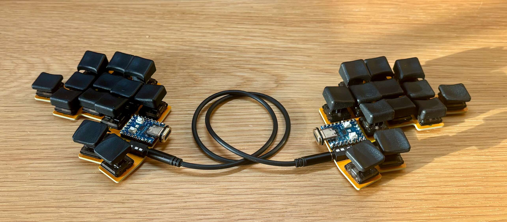
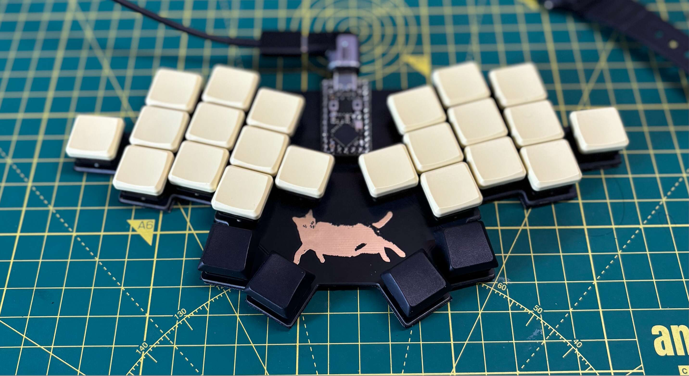
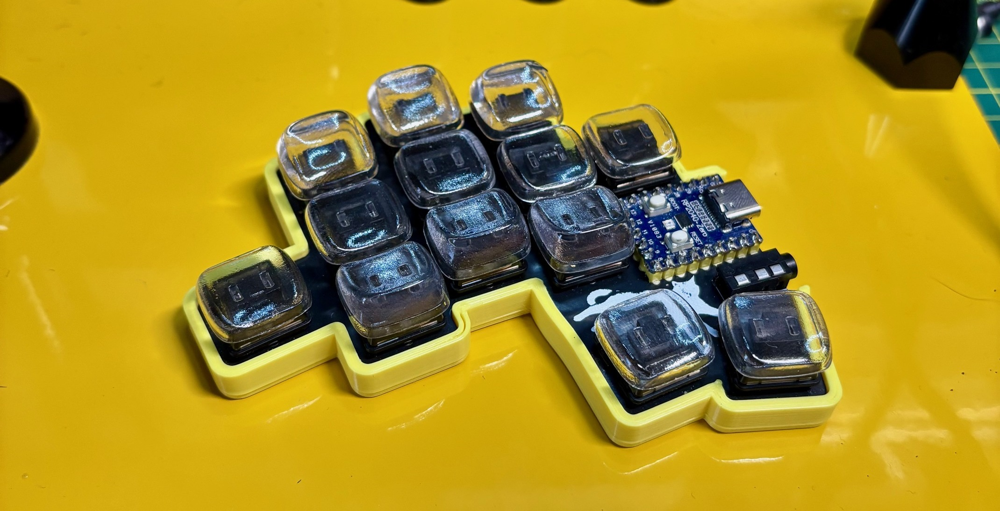
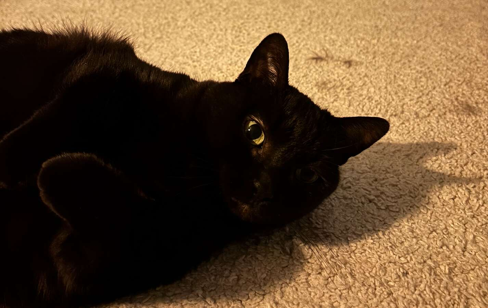

# Smallcat

A diodeless 26-key keyboard, featuring the purr-fect code reviewer, my cat, Lila.

This repo contains Gerber files, KiCad files, my keymap, and links to QMK and Vial-QMK firmware for the Smallcat.

## Versions

There are two versions of the Smallcat: **split** and **unibody**.

Both versions share the same column splay:

| Finger | Splay |
|--------|-------|
| Pinkie | 10°   |
| Ring   | 5°    |
| Middle | 2°    |

### Split

| Component | Specification |
|-----------|---------------|
| Controller | 2x RP2040-Zero footprint ([example](https://www.waveshare.com/wiki/RP2040-Zero)) |
| Switches | 26 low profile Choc (soldered) |
| Diodes | None required |
| Connection | TRRS jack |

### Unibody

| Component | Specification |
|-----------|---------------|
| Controller | 1x RP2040 Pro Micro with 28 I/O pins ([example](https://www.aliexpress.com/i/1005006097129434.html)) |
| Switches | 26 low profile Choc (soldered) |
| Diodes | None required |

#### Build notes

The unibody version has a few unconventional details:

- **Pro Micro model**: Use a Pro Micro with extra pins (18 and 24) near the middle of the board.

- **Pin clearance**: The space between pins 18 and 24 is narrow. You may need to trim the plastic between them, just ensure enough remains so the metal contacts don't touch. [See photo](./assets/pins_uni.jpeg). This is a simple workaround to use the extra pins and keep the board diodeless.

- **Pin headers**: PCB holes are narrower than standard. Use machined conical pin headers like [these](https://www.proto-advantage.com/store/datasheets/MPH100IMP40M-G-V-TH.pdf).

- **Controller orientation**: Install component-side up (not face-down like most keyboards). This way the boot and reset buttons are accessible.

#### Unibody v2.0 (work in progress)

A more compact revision of the unibody, in [`pcb/uni-v2`](./pcb/uni-v2). It has not been built yet, and there is no case for it.

It uses the same controller, switches, pinout and firmware as the unibody above. The Pro Micro model, pin clearance and controller orientation build notes still apply.

What changed:

- **Closer together**: the two halves are pulled in towards each other and angled a little more, so your hands sit nearer the middle. The thumb keys also moved up slightly, closer to the bottom row.
- **Controller tucked in**: the controller is now tilted and squeezed in between the inner index keys, instead of sitting upright in the middle with empty board around it.
- **Less board**: the parts of the PCB that were doing nothing are gone, around the controller and between the thumb keys. It is about 5 mm narrower and 9% smaller overall.
- **Cleaner front**: the traces moved to the back, so the front is just Lila.
- **Normal pin headers work**: the controller holes are wider, so you no longer need the special machined pins. Standard headers fit, and the machined ones still do too.
- **Properly symmetrical**: the two halves are now exact mirrors of each other. The first unibody was off by a tenth of a millimetre here and there.
- **Two Lilas**: one on each half, facing outwards.

## Case

Simple press-fit cases with no screws or hardware. The base is 1mm larger than the PCB, allowing it to slide in snugly. You may need to trim some edges slightly to ensure a tight fit. Small bumpons under the PCB prevent the pins from resting directly on the case.

| Split | Uni |
|-------|-----|
|  |  |

## Firmware

I maintain my own [QMK keymap](https://github.com/smallwat3r/qmk-keymap), which includes my keymap, configuration for the Smallcat, and a ready-to-flash UF2 file.

